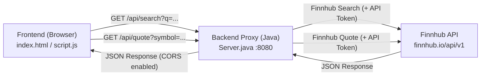

# Project Context: Simple Stock Screener

## 1. Project Overview
**Simple Stock Screener** is a lightweight, zero-dependency full-stack stock tracking web application designed as an educational/college project. It allows users to search for publicly traded companies (US common stocks) using the Finnhub API and maintain a persistent watchlist with real-time price quotes, dollar changes, and percentage changes.

---

## 2. Architecture & Design Principles
The project emphasizes simplicity, educational clarity, and ease of deployment:
- **Zero Build Tools / Dependencies**: No Maven, Gradle, npm, Webpack, or external libraries.
- **Built-in Java HTTP Server**: Uses standard JDK networking and HTTP libraries.
- **Vanilla Frontend**: Pure HTML5, CSS3 (dark-themed), and ES6+ JavaScript.
- **Local Persistence**: Client-side storage via browser `localStorage` for watchlist data.
- **Secure API Key Handling**: The backend acts as a reverse proxy, keeping the third-party API key stored safely in a local `.env` file instead of exposing it to client-side code.



---

## 3. Directory & File Structure

```
E:/stockscreener/
├── .env                  # Environment file storing the Finnhub API key
├── .gitignore            # Git ignore file (excludes .env and *.class)
├── context.md            # Comprehensive project documentation and architecture context
├── README.md             # High-level overview and run instructions
├── run.bat               # Windows batch script to compile and launch the backend
├── Server.java           # Lightweight Java HTTP proxy server
├── Server.class          # Compiled bytecode of Server.java
└── frontend/
    ├── index.html        # Main HTML layout for search and watchlist table
    ├── script.js         # Client-side logic, API calls, and localStorage handling
    └── style.css         # Dark-themed UI styling
```

---

## 4. Component Details

### Backend: [`Server.java`](file:///E:/stockscreener/Server.java)
- **Class**: [`Server`](file:///E:/stockscreener/Server.java#L15-L100)
- **Runtime**: Java 11+ (uses `java.net.http.HttpClient` and `com.sun.net.httpserver.HttpServer`).
- **Port**: `8080`.
- **CORS Support**: Adds header `Access-Control-Allow-Origin: *` to all responses.
- **Configuration**:
  - Reads `STOCK_API_KEY` from `.env` using standard `java.util.Properties`.
- **Endpoints**:
  - `GET /`: Serves static frontend files (`index.html`, `style.css`, `script.js`) directly from `frontend/`.
  - `GET /api/search?q=<query>`: Proxies to `https://finnhub.io/api/v1/search?q=<query>&token=<apiKey>`.
  - `GET /api/quote?symbol=<symbol>`: Proxies to `https://finnhub.io/api/v1/quote?symbol=<symbol>&token=<apiKey>`.
  - Returns `404` for non-existent files or unrecognized `/api/*` paths.
  - Returns `500` if network or parsing exceptions occur during upstream fetching.

### Frontend: `frontend/`
- **[`frontend/index.html`](file:///E:/stockscreener/frontend/index.html)**:
  - Header with search input (`#search-input`) and search action button (`#search-btn`).
  - Search results dropdown container (`#search-results`) with dynamic result items.
  - Watchlist table (`#watchlist-table-body`) showing:
    - Company (Name & Ticker Symbol)
    - Current Price (`$`)
    - Price Change (`+$` / `-$`)
    - Change % (`+%` / `-%`)
    - Watchlist Toggle/Remove button (★)
- **[`frontend/script.js`](file:///E:/stockscreener/frontend/script.js)**:
  - **Constants**:
    - `API_QUOTE`: `http://localhost:8080/api/quote?symbol=`
    - `API_SEARCH`: `http://localhost:8080/api/search?q=`
  - **State**:
    - `watchlist`: Array of objects `[{ symbol: string, name: string }]` stored in `localStorage` key `'watchlist_full'`.
  - **Key Functions**:
    - [`handleSearch()`](file:///E:/stockscreener/frontend/script.js#L14-L60): Queries backend search API, filters for `r.type === 'Common Stock'`, takes top 5 matches, and renders them.
    - [`addToWatchlist(symbol, name)`](file:///E:/stockscreener/frontend/script.js#L63-L72): Appends stock to `watchlist` in `localStorage` and triggers price refreshes.
    - [`removeFromWatchlist(symbol)`](file:///E:/stockscreener/frontend/script.js#L75-L79): Filters item out of `watchlist` in `localStorage` and re-renders table.
    - [`loadWatchlistPrices()`](file:///E:/stockscreener/frontend/script.js#L82-L113): Loops sequentially over watchlist symbols, fetches current quotes from `/api/quote`, and passes formatted records to `renderTable()`.
    - [`renderTable(data)`](file:///E:/stockscreener/frontend/script.js#L116-L143): Dynamically populates the watchlist HTML table with green/red positive/negative styling.
- **[`frontend/style.css`](file:///E:/stockscreener/frontend/style.css)**:
  - Dark mode CSS variables (`--bg-color: #121212`, `--card-bg: #1e1e1e`, `--positive: #4caf50`, `--negative: #f44336`, `--accent: #2196f3`).
  - Card-based layout with clean typography (`Segoe UI`), responsive buttons, and formatted table borders.

---

## 5. Environment & Configuration

### [`.env`](file:///E:/stockscreener/.env)
Contains the Finnhub API key:
```env
STOCK_API_KEY=your_finnhub_api_key_here
```
> [!IMPORTANT]
> The `.env` file is excluded from version control via [`.gitignore`](file:///E:/stockscreener/.gitignore) to protect credentials.

---

## 6. How to Run & Test

### Option A: Using Windows Batch Script
Execute [`run.bat`](file:///E:/stockscreener/run.bat) from the project root:
```cmd
run.bat
```

### Option B: Manual Execution
1. **Compile Backend**:
   ```cmd
   javac Server.java
   ```
2. **Start Backend**:
   ```cmd
   java Server
   ```
   *Expected output: `Backend running on port 8080`*
3. **Open Frontend**:
   - Double-click or open [`frontend/index.html`](file:///E:/stockscreener/frontend/index.html) in any modern web browser.

---

## 7. Future Enhancement Opportunities
- **Concurrent Price Fetching**: Use `Promise.all` in [`loadWatchlistPrices()`](file:///E:/stockscreener/frontend/script.js#L82-L113) for parallel quote fetching instead of sequential `for...of` requests.
- **Auto-Refresh**: Implement `setInterval` polling to refresh watchlist prices automatically every 15-60 seconds.
- **Enhanced Metrics**: Show 52-week high/low, day high/low, and market cap.
- **Static File Serving**: Extend [`Server.java`](file:///E:/stockscreener/Server.java) to serve files from `frontend/` directly, eliminating the need to open `index.html` via `file://`.
